<p align="center">
  
</p>

<h1 align="center">귀가온</h1>

<p align="center">
  대리운전 중 차가 운행을 지켜보고 이상을 알려,<br>
  승객과 기사 모두의 안전한 귀가를 확인하는 Pleos Connect 앱
</p>

<p align="center">
  
  
  
  
</p>

<p align="center">
  <a href="#9-apk-위치"><b>APK 다운로드</b></a> &nbsp;·&nbsp;
  <a href="#7-실행-방법"><b>실행 방법</b></a> &nbsp;·&nbsp;
  <a href="#3-전체-운행-따라가기"><b>전체 운행 보기</b></a>
</p>

<p align="center">
  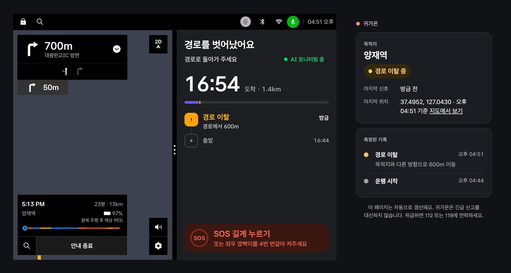
</p>
<p align="center"><sub>경로를 벗어난 순간. 왼쪽은 차량 화면(내비게이션 | 귀가온), 오른쪽은 같은 시각 비상 연락처의 휴대폰.</sub></p>

<br>

## 1. 한눈에 보기

<table>
  <tr>
    <th width="140">문제</th>
    <td>대리운전은 늦은 밤, 처음 만난 두 사람이 닫힌 차 안에 단둘이 있는 서비스입니다. 승객은 취해 있거나 잠들어 있고, 기사는 운전 중에 자리를 뜰 수 없습니다. 그런데 그 차 안을 지켜보는 사람은 아무도 없습니다. 가족이 아는 것은 "출발했다"는 사실뿐입니다.</td>
  </tr>
  <tr>
    <th>해결</th>
    <td>귀가온은 승객의 휴대폰이 아니라 <b>차에서</b> 동작합니다. 출발부터 승객이 차에서 내릴 때까지 차량 신호로 운행을 지켜보고, 경로 이탈·장시간 정차·SOS를 비상 연락처에게 실시간으로 알립니다. 운행의 끝은 '도착'이 아니라 <b>승객의 하차</b>로 확인합니다.</td>
  </tr>
  <tr>
    <th>차라서 가능한 것</th>
    <td>기어로 운행을 자동으로 시작하고, 승객석 착석으로 하차를 확인하고, 방향지시등으로 손을 떼지 않고 SOS를 보내고, 차의 목소리로 승객의 도착 안내를 읽어 줍니다. 승객이 앱을 켜거나 휴대폰을 들고 있을 필요가 없습니다.</td>
  </tr>
</table>

<br>

## 2. 핵심 기능

<table>
  <tr>
    <td width="50%" valign="top">
      <b>자동 운행 시작</b><br>
      기어를 P에서 빼거나 운행 시작을 누르면 모니터링이 시작되고, 승객의 목적지가 내비게이션에 입력됩니다.
    </td>
    <td width="50%" valign="top">
      <b>경로 이탈 · 장시간 정차 감지</b><br>
      목적지와 다른 방향으로 이동하거나 목적지가 아닌 곳에 오래 멈추면 기사 화면과 비상 연락처 페이지에 바로 표시됩니다.
    </td>
  </tr>
  <tr>
    <td valign="top">
      <b>SOS</b><br>
      화면의 SOS를 길게 누르거나 방향지시등을 좌우로 빠르게 바꾸면 위치와 함께 전송됩니다. 네트워크가 끊겨도 차에 보관했다가 연결되는 즉시 가장 먼저 보냅니다.
    </td>
    <td valign="top">
      <b>실시간 비상 연락처 페이지</b><br>
      QR을 한 번 스캔해 두면 이후 모든 운행을 앱 설치 없이 링크 하나로 봅니다. 지도 위의 점이 아니라 "경로 이탈 중" 같은 문장으로 상황을 보여 줍니다.
    </td>
  </tr>
  <tr>
    <td valign="top">
      <b>AI 대화 감지</b><br>
      차 안에서 폭언이나 도움 요청이 감지되면 "괜찮으신가요?"를 묻고, 응답이 없으면 비상 연락처에게 알립니다. 대화 내용은 저장하지 않습니다.
    </td>
    <td valign="top">
      <b>음성 도착 안내</b><br>
      승객이 남긴 출입문·주차·차키 메모를 Claude가 한 문장으로 다듬어, 목적지 근처에서 차가 기사에게 읽어 줍니다.
    </td>
  </tr>
  <tr>
    <td valign="top">
      <b>안전 귀가 확인</b><br>
      도착 후 승객석이 비면 '안전 귀가'로 끝납니다. 승객이 내리지 않으면 하차 대기로 넘어가 비상 연락처에게 알립니다.
    </td>
    <td valign="top">
      <b>운행 로그와 AI 리포트</b><br>
      모든 이벤트가 시각·위치와 함께 수정할 수 없게 남고, 운행이 끝나면 Claude가 무슨 일이 있었는지 요약합니다.
    </td>
  </tr>
</table>

<br>

## 3. 전체 운행 따라가기

강남역에서 양재역까지, 실제 릴리스 APK로 한 번의 운행을 처음부터 끝까지 기록했습니다. 차량 화면은 Pleos Connect 에뮬레이터에서 내비게이션(왼쪽)과 귀가온(오른쪽)을 나란히 띄운 모습이고, 휴대폰은 같은 순간의 비상 연락처 페이지입니다. 모든 화면은 야간 모드입니다.

### ① 설정 &nbsp;<sub>정차 중에만</sub>

<table>
  <tr>
    <td align="center" width="33%">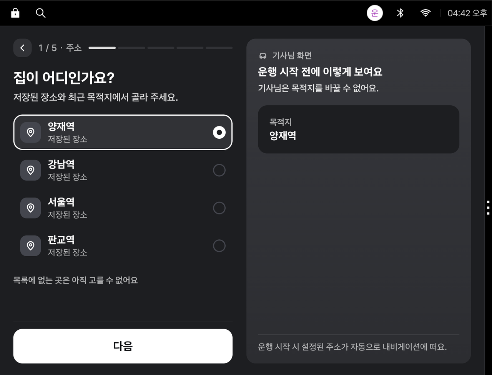</td>
    <td align="center" width="33%">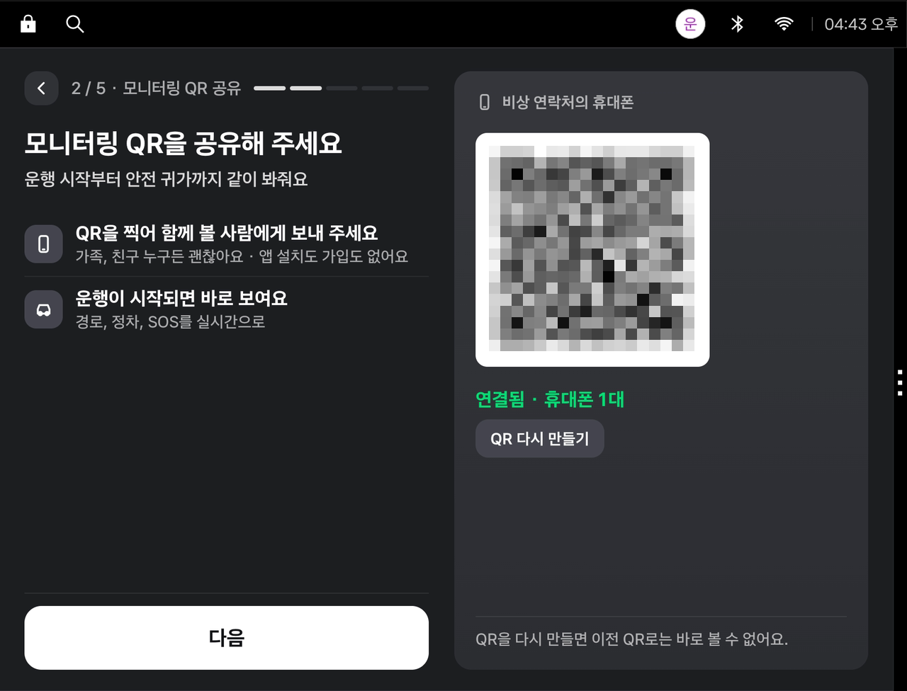</td>
    <td align="center" width="33%">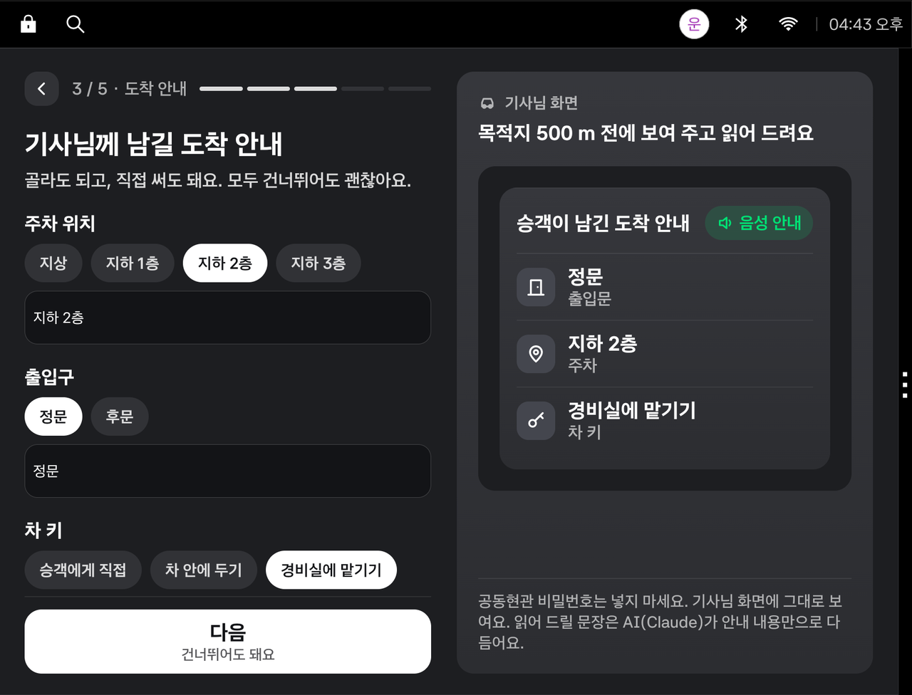</td>
  </tr>
  <tr>
    <td align="center"><sub>목적지</sub></td>
    <td align="center"><sub>비상 연락처 QR</sub></td>
    <td align="center"><sub>도착 안내 메모</sub></td>
  </tr>
</table>

승객이 출발 전에 목적지, 비상 연락처, 도착 안내를 저장합니다. 비상 연락처는 QR을 한 번만 스캔하면 되고, 이후 운행마다 다시 공유할 필요가 없습니다.<br>
<sub>차량 신호: 기어 P(정차). 주행 중에는 설정을 열 수 없습니다.</sub>

### ② 운행 시작

<table>
  <tr>
    <td width="72%">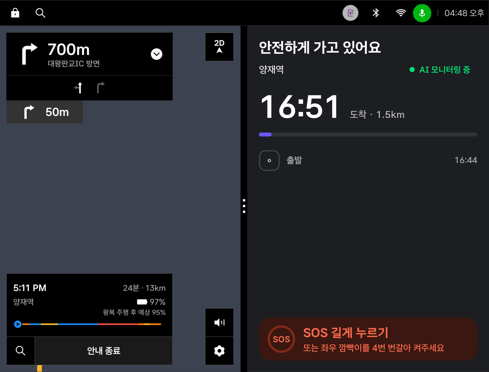</td>
    <td width="28%">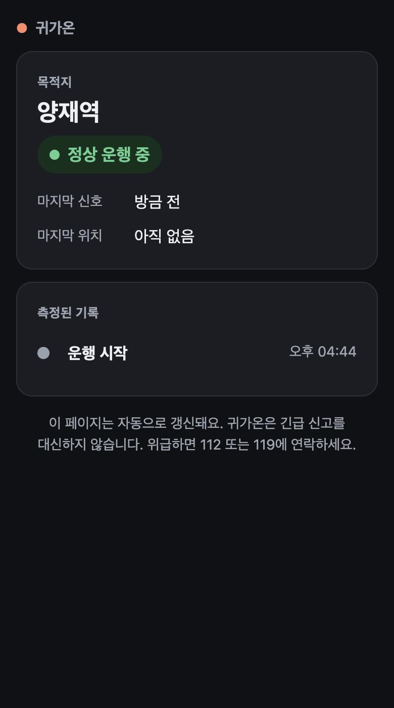</td>
  </tr>
</table>

기어를 D로 바꾸자 운행이 시작되고, 기사 화면에는 도착 예정 시각과 SOS만 크게 남습니다. 비상 연락처 페이지에는 "정상 운행 중"이 뜹니다.<br>
<sub>차량 신호: 기어 P → D, GPS, 내비게이션 목적지. 대화 감지가 켜져 있으면 "AI 모니터링 중"이 표시됩니다.</sub>

### ③ 주행 중 이벤트

<table>
  <tr>
    <td width="72%">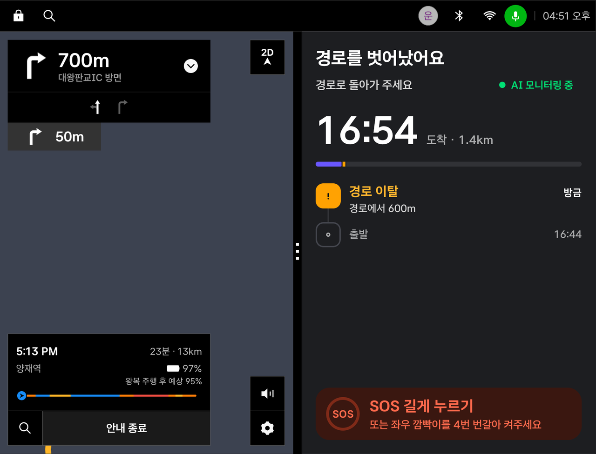</td>
    <td width="28%">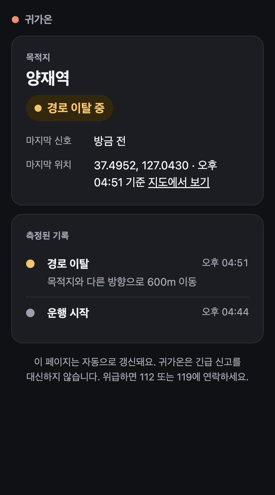</td>
  </tr>
</table>

**경로 이탈.** 차가 목적지와 다른 방향으로 600 m 이동하자 양쪽 화면에 "경로를 벗어났어요"가 뜹니다.<br>
<sub>차량 신호: GPS와 목적지 사이 거리. 300 m 이상 벗어난 상태가 60초 이어지면 이탈로 판단합니다.</sub>

<table>
  <tr>
    <td width="72%">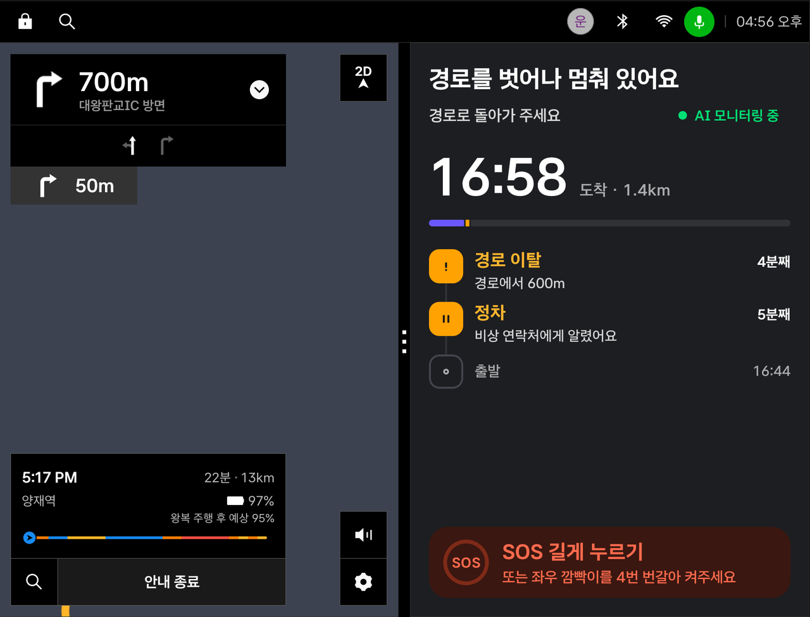</td>
    <td width="28%">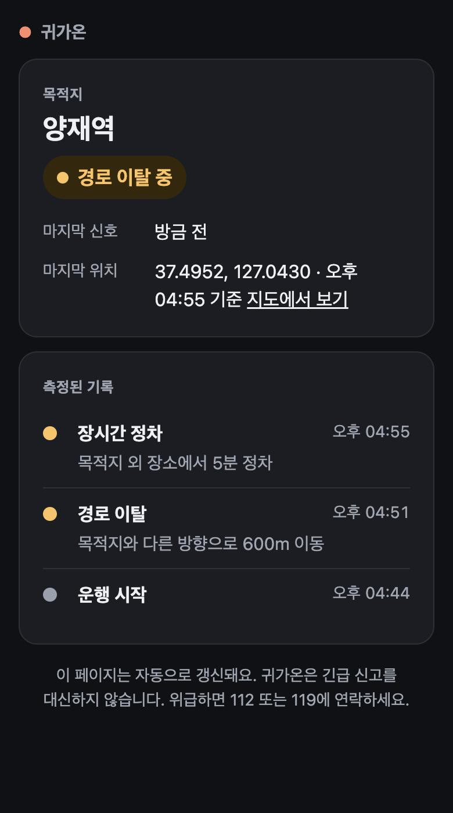</td>
  </tr>
</table>

**장시간 정차.** 목적지가 아닌 곳에서 5분 넘게 멈추자 정차 시간과 함께 알려지고, 다시 출발하면 기록이 이어집니다.<br>
<sub>차량 신호: 속도 0과 GPS 위치. 목적지 500 m 밖에서 5분 이상 정차하면 알립니다.</sub>

### ④ SOS

<table>
  <tr>
    <td width="72%"></td>
    <td width="28%">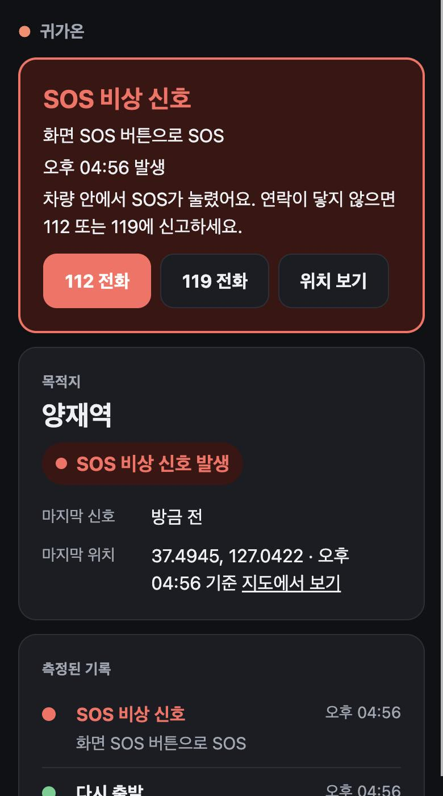</td>
  </tr>
</table>

주행 중에 SOS를 1.5초 길게 누르면 링이 차오른 뒤 SOS가 전송되고, 112 긴급 통화 버튼이 뜹니다. 비상 연락처 페이지는 빨간 경고로 바뀝니다. 잘못 눌렀다면 바로 취소할 수 있고, 취소도 기록됩니다.<br>
<sub>차량 신호: 화면 길게 누르기, 또는 방향지시등 좌우 4번 전환(6초 안). 운전대에서 손을 떼지 않고도 보낼 수 있습니다.</sub>

### ⑤ 도착

<table>
  <tr>
    <td width="72%" align="center">
      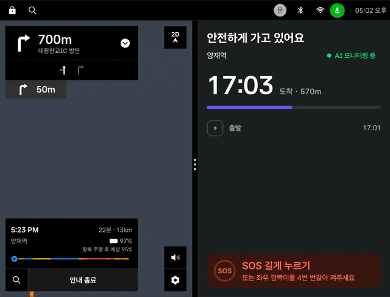
    </td>
    <td width="28%">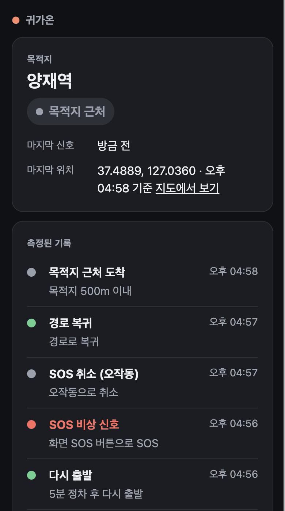</td>
  </tr>
</table>

<sub>소리와 함께 보기 (14초): 차가 도착 안내를 읽어 주는 장면입니다. 재생되지 않으면 <a href="docs/showcase/arrival-voice.mp4">mp4 파일</a>을 여세요.</sub>

https://github.com/user-attachments/assets/1e08d989-4c7f-42ea-b294-a34f14190312

**목적지 근처.** 500 m 안에 들어오면 승객이 남긴 도착 안내가 카드로 뜨고, 차가 소리 내어 읽어 줍니다. 읽는 문장은 승객의 메모(정문, 지하 2층, 경비실에 맡기기)를 Claude가 자연스러운 한 문장으로 다듬은 것입니다. 기사는 잠든 승객을 깨워 묻지 않아도 됩니다.<br>
<sub>차량 신호: GPS와 목적지 거리, Pleos TTS(차량 스피커).</sub>

<table>
  <tr>
    <td width="72%">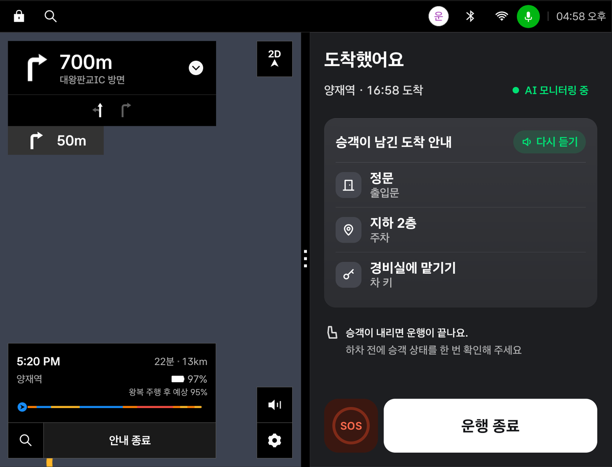</td>
    <td width="28%">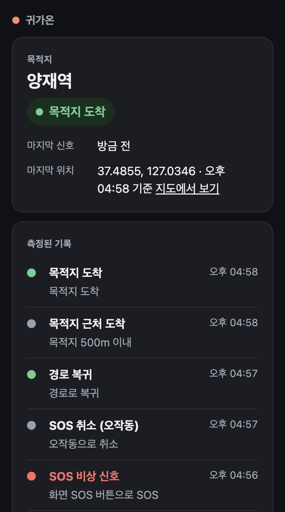</td>
  </tr>
  <tr>
    <td>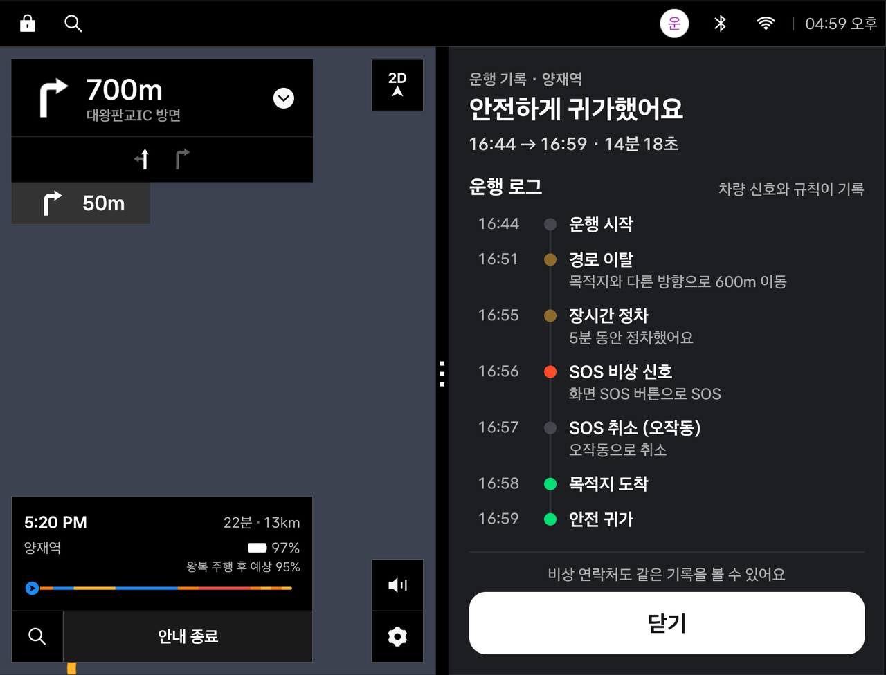</td>
    <td>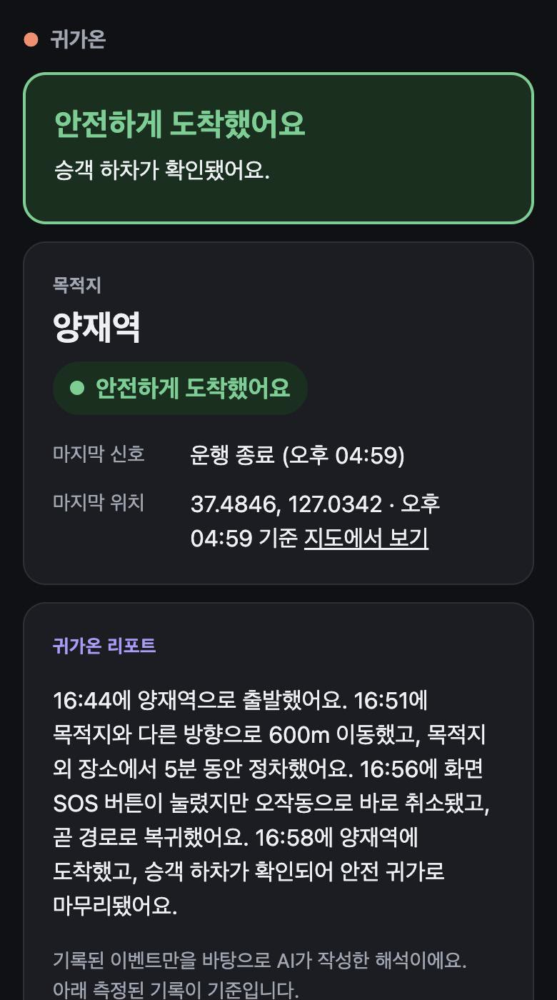</td>
  </tr>
</table>

**도착과 안전 귀가.** 100 m 안에 들어와 주차하면 도착으로 바뀌고, 승객석이 비는 순간 "안전하게 귀가했어요"로 운행이 끝납니다.<br>
<sub>차량 신호: 기어 P, 승객석·뒷좌석 착석.</sub>

<table>
  <tr>
    <td width="72%">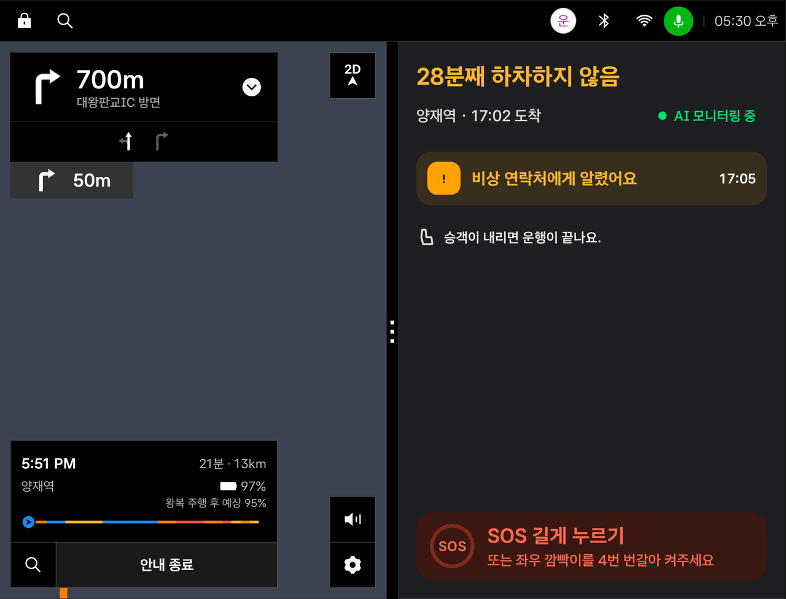</td>
    <td width="28%">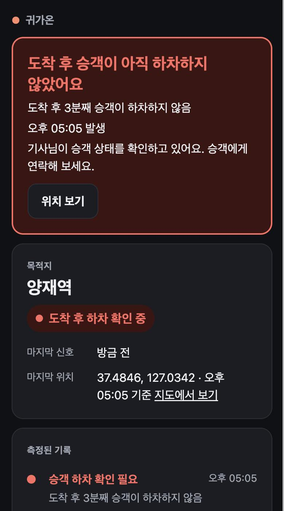</td>
  </tr>
</table>

**승객이 내리지 않으면.** 도착해 주차한 뒤 3분이 지나도 승객석에 사람이 앉아 있으면 운행을 끝내지 않고 하차 대기로 넘어갑니다. 차 화면에는 몇 분째 하차하지 않았는지가 뜨고, 비상 연락처 페이지는 "도착 후 승객이 아직 하차하지 않았어요" 경고로 바뀝니다. 잠든 승객이 주차장의 차 안에 홀로 남겨지지 않도록, 승객이 실제로 내려야 운행이 끝납니다.<br>
<sub>차량 신호: 기어 P, 승객석·뒷좌석 착석이 3분 넘게 이어짐. 승객이 내리는 순간 안전 귀가로 끝납니다.</sub>

### ⑥ 리포트

<table>
  <tr>
    <td width="72%">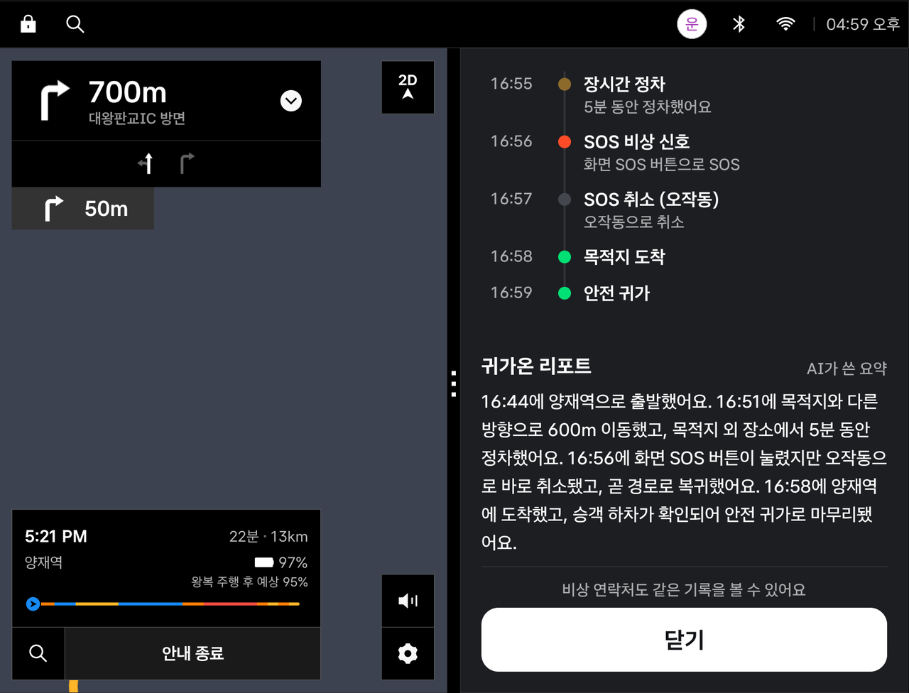</td>
    <td width="28%" align="center">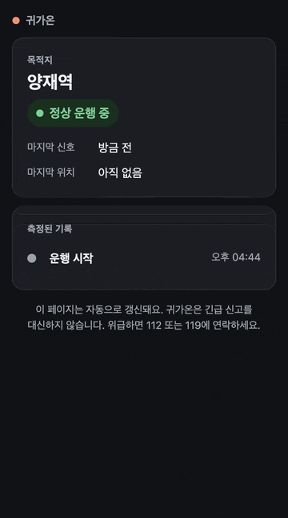</td>
  </tr>
</table>

운행이 끝나면 Claude가 운행 로그만으로 요약을 씁니다. 이번 운행의 실제 리포트:

> 16:44에 양재역으로 출발했어요. 16:51에 목적지와 다른 방향으로 600m 이동했고, 목적지 외 장소에서 5분 동안 정차했어요. 16:56에 화면 SOS 버튼이 눌렸지만 오작동으로 바로 취소됐고, 곧 경로로 복귀했어요. 16:58에 양재역에 도착했고, 승객 하차가 확인되어 안전 귀가로 마무리됐어요.

<sub>오른쪽은 같은 운행 동안 비상 연락처 페이지가 바뀐 순서입니다. 리포트는 비상 연락처 페이지에도 똑같이 뜹니다.</sub>

<br>

## 4. Pleos SDK 활용

| 기능 | 차량 신호 · SDK | 주행 / 정차 |
|---|---|---|
| 자동 운행 시작, 주행 중 화면 제한 | Vehicle SDK 기어 | 둘 다 |
| 경로 이탈, 장시간 정차, 도착 | Vehicle SDK GPS · 속도, NaviHelper 목적지 · 남은 시간 | 둘 다 |
| 목적지 자동 입력 | NaviHelper | 정차 |
| SOS (방향지시등) | Vehicle SDK 방향지시등 | 둘 다 |
| SOS (화면 길게 누르기) | 화면 입력 | 둘 다 |
| 안전 귀가 확인, 하차 대기 | Vehicle SDK 승객석 · 뒷좌석 착석 | 정차 |
| 음성 도착 안내 | Pleos TTS | 둘 다 |
| AI 대화 감지 | Pleos STT | 둘 다 |
| 설정, PIN, 운행 기록 | 화면 입력 | 정차만 |

<sub>사용 버전: Vehicle SDK 2.3.2, NaviHelper 3.0.5, Pleos TTS 3.3.1, Pleos STT 3.3.1.</sub>

<br>

## 5. 운전 중에도 안전하게

<table>
  <tr>
    <td width="50%">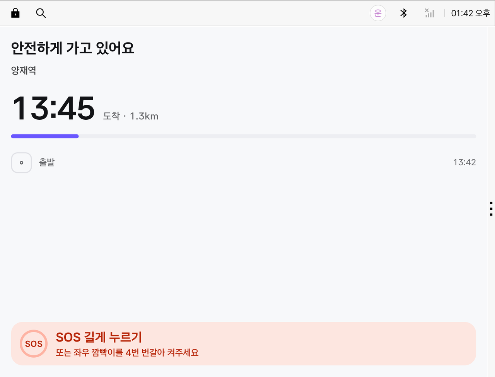</td>
    <td width="50%"></td>
  </tr>
  <tr>
    <td align="center"><sub>주간 · 전체 화면</sub></td>
    <td align="center"><sub>야간 · 내비게이션 옆 절반 화면</sub></td>
  </tr>
</table>

- 주행 중에는 상태 한 줄, 도착 예정 시각, SOS만 보입니다. 입력이 필요한 화면(설정, PIN, 기록)은 기어가 P일 때만 열립니다.
- 글자와 터치 영역은 Pleos 디자인 가이드의 차량용 기준을 따르고, 주간·야간 모두 명암비 4.5:1 이상을 지킵니다.
- 주행 중 알림은 화면을 가리지 않고 같은 자리에서 바뀌며, 필요한 안내는 소리로 전합니다.

<br>

## 6. 구조와 개인정보

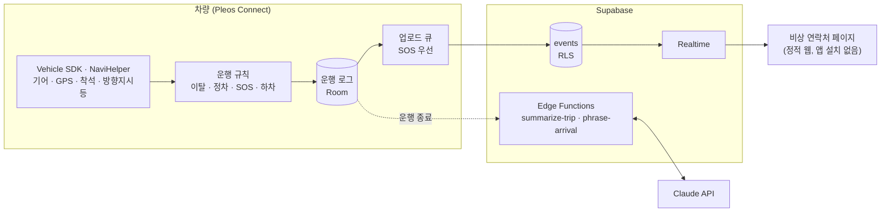

- 판단은 차 안의 규칙이 합니다. SOS와 이상 감지는 AI나 네트워크를 기다리지 않고, 끊겨 있으면 차에 보관했다가 연결되는 즉시 보냅니다.
- 비상 연락처는 QR 링크의 토큰으로 자기에게 연결된 차의 운행만 볼 수 있습니다. 모든 테이블에 Row Level Security가 켜져 있고, 앱에는 공개(publishable) 키만 들어 있습니다.
- 대화 감지는 위험 신호만 남기고 대화 내용은 저장하지 않습니다. AI에는 운행 이벤트와 승객이 직접 쓴 도착 메모만 보냅니다.

<br>

## 7. 실행 방법

**준비물:** Pleos Connect Emulator 2.1.0 (Android Automotive 14, API 34), Android SDK platform-tools(`adb`).

```bash
adb install apk/귀가온_release.apk
```

1. 에뮬레이터에서 귀가온을 열고, 위치·마이크 권한을 허용합니다.
2. 설정에서 목적지를 **양재역**으로 저장합니다. 비상 연락처 화면의 QR을 휴대폰으로 스캔하면 비상 연락처 페이지를 함께 볼 수 있습니다.
3. 에뮬레이터의 Virtual Console을 엽니다. 기어, 착석, 방향지시등을 바꾸는 데 쓰이며, 데모 동안 페이지를 앞에 띄워 두어야 합니다.

   ```bash
   adb forward tcp:8088 tcp:8088   # 그다음 브라우저에서 http://127.0.0.1:8088
   ```

4. 데모 운행을 재생합니다. 강남역에서 출발해 기어를 D로 바꾸고, 경로 이탈 → 6분 정차 → 양재역 도착 순서로 GPS를 보냅니다.

   ```bash
   scripts/demo-route.sh run
   ```

5. 운행 중 SOS는 화면의 SOS를 길게 누르거나, 방향지시등 패턴을 보냅니다.

   ```bash
   scripts/demo-route.sh sos
   ```

6. 도착 후 승객이 내린 것으로 바꾸면 안전 귀가로 운행이 끝나고 AI 리포트가 뜹니다.

   ```bash
   scripts/demo-route.sh seats empty
   ```

> [!NOTE]
> 릴리스 빌드는 실제 차량 기준 시간을 씁니다. 도착 후 승객석이 비면 바로 안전 귀가로 끝나지만, 주차한 뒤 **3분** 동안 승객이 계속 앉아 있으면 그때 하차 대기로 넘어가 비상 연락처에게 알립니다. 그 밖의 기준: 경로 이탈 300 m · 60초, 장시간 정차 5분, 목적지 근처 500 m, 도착 100 m, SOS 길게 누르기 1.5초.

<details>
<summary><b>소스에서 빌드하기</b></summary>

<br>

Android Studio에 들어 있는 JBR을 씁니다.

```bash
export JAVA_HOME="/Applications/Android Studio.app/Contents/jbr/Contents/Home"
./gradlew assembleDebug        # 디버그 빌드 (로컬 Supabase 10.0.2.2:54321)
./gradlew installDebug
```

디버그 빌드는 로컬 Supabase에 연결되고, 데모용으로 하차 대기로 넘어가는 시간이 3분 대신 30초입니다. 로컬 스택:

```bash
supabase start
supabase db reset                       # migrations + seed
supabase functions serve summarize-trip --env-file supabase/.env.local
python3 -m http.server 8080 -d web/contact   # 비상 연락처 페이지
```

릴리스 빌드에는 `local.properties`의 `gwigaon.release.supabaseUrl` · `.supabaseKey` · `.contactPageUrl`과, 서명용 `keystore.properties`가 필요합니다. 둘 다 저장소에 넣지 않습니다.

```bash
./gradlew assembleRelease
```

</details>

<br>

## 8. 테스트 환경

| 항목 | 버전 |
|---|---|
| 에뮬레이터 | Pleos Connect Emulator 2.1.0, AVD `Pleos_Connect_v2.1.0` (Android Automotive 14, API 34) |
| 개발 환경 | macOS (Apple silicon), Android Studio JBR (OpenJDK 25), Gradle 9.9.0, AGP 9.5.1 |
| 앱 | Kotlin 2.4.21, Jetpack Compose BOM 2026.09.00, Room 2.8.5, minSdk 28 · targetSdk 34 |
| 클라우드 | Supabase CLI 2.122.0 (Postgres, Realtime, Edge Functions), Deno 2.9.8, Claude API (`claude-opus-5-5`) |

| 테스트 | 명령 | 개수 |
|---|---|---|
| 단위 테스트 (JVM) | `./gradlew test` | 529 |
| UI · 계측 테스트 (에뮬레이터) | `./gradlew connectedAndroidTest` | 83 |
| 데이터베이스 · RLS (pgTAP) | `supabase test db` | 93 |
| Edge Function · 연락처 페이지 (Deno) | `deno test supabase/functions/ web/contact/` | 45 |
| 정적 분석 | `./gradlew lint` | |

`connectedAndroidTest`는 끝나면 앱을 지우므로, 다시 `installDebug` 하고 위치·마이크 권한을 허용해야 합니다.

<br>

## 9. APK 위치

[`apk/귀가온_release.apk`](apk/귀가온_release.apk) (서명된 릴리스 빌드, 약 48 MB). 클라우드(비상 연락처 페이지, AI 리포트)에 연결된 상태로 빌드했습니다.

<br>

## 10. 프로젝트 구조 · 라이선스

<details>
<summary><b>프로젝트 구조</b></summary>

<br>

```
app/                  Android 앱 (Kotlin, Jetpack Compose)
  src/main/java/com/coral/gwigaon/
    vehicle/          차량 신호 (Vehicle SDK, NaviHelper)
    route/            경로 이탈 · 정차 · 도착 판단
    trip/             운행 상태와 화면, PIN, 하차 확인
    sos/              SOS (화면 길게 누르기, 방향지시등)
    cues/             AI 대화 감지
    arrival/          음성 도착 안내
    report/           운행 리포트
    sync/             업로드 큐, 비상 연락처 연결
    ui/theme/         디자인 토큰 (주간 · 야간)
supabase/
  migrations/         스키마와 RLS 정책
  functions/          summarize-trip, phrase-arrival (Claude)
  tests/              pgTAP 테스트
web/contact/          비상 연락처 페이지 (정적 웹)
scripts/              demo-route.sh, demo-check.sh, 검사 스크립트
apk/                  릴리스 APK
docs/                 설계 결정 기록(ADR), 쇼케이스 이미지
```

</details>

<details>
<summary><b>라이선스</b></summary>

<br>

현대자동차그룹 차량용 앱 개발 챌린지 심사를 위해 공개한 저장소입니다. 별도의 오픈소스 라이선스는 붙이지 않았습니다.

사용한 외부 구성 요소: Pleos Connect SDK (Hyundai Motor Group), AndroidX · Jetpack Compose · Room · Kotlin Coroutines (Apache 2.0), ZXing (Apache 2.0), Supabase. 화면 디자인은 Pleos 디자인 가이드의 차량용 기준을 참고했습니다.

</details>
